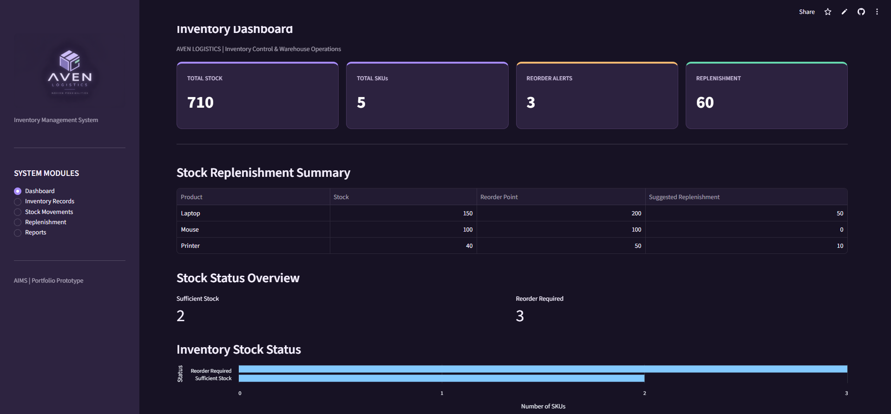
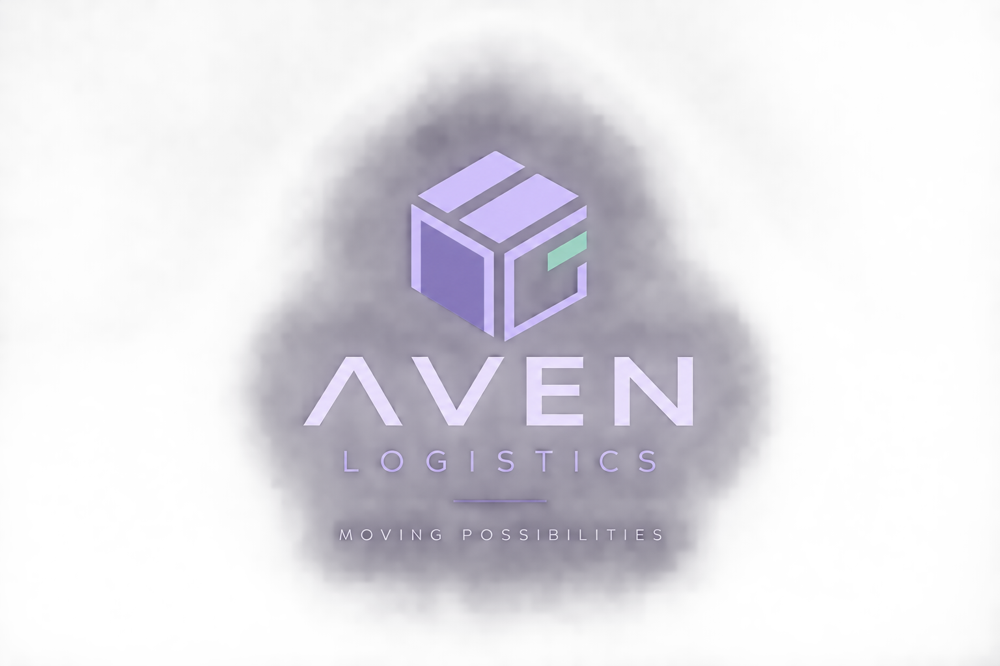

# AVEN Inventory Management System (AIMS)

**A Python-Based Warehouse Inventory Management System**

[Click here to launch AIMS](https://aven-inventory-management.streamlit.app/)!

Explore the interactive warehouse inventory management prototype, including inventory tracking, stock movements, replenishment monitoring, and reporting.

## Application Preview

### Inventory Dashboard

AIMS is a prototype inventory management application developed using Python, Streamlit, and SQLite. The project demonstrates how digital tools can support warehouse operations through inventory tracking, stock movement recording, replenishment monitoring, and data visualisation.

## Project Objectives

The system was developed to explore how programming and database technologies can improve inventory visibility, reduce reliance on manual tracking, and support stock replenishment decisions.

## Key Features

- **Inventory Dashboard:** Displays total stock, number of SKUs, reorder alerts, and suggested replenishment quantities.
- **Inventory Records:** Allows users to view, search, filter, and add products.
- **Stock Movement Management:** Records stock-in and stock-out transactions and updates inventory quantities.
- **Replenishment Alerts:** Identifies products requiring replenishment based on predefined reorder points.
- **Stock Movement Analytics:** Summarises stock movements and transaction history.
- **Inventory Reports:** Enables users to export inventory and replenishment data as CSV files.
- **Data Visualisation:** Displays stock status and inventory performance through charts.

## Technologies Used

| Technology | Purpose |
|---|---|
| Python | Application logic and inventory calculations |
| Streamlit | Interactive web application |
| SQLite | Local database for inventory records and stock movement transactions |
| CSV | Report generation and data export |

## Inventory Management Logic

AIMS uses predefined reorder points to identify products that require replenishment.

**Suggested Replenishment = Maximum(0, Reorder Point − Current Stock)**

The application also records stock movements to maintain updated inventory quantities.

### Reorder Alert Logic

AIMS adopts a proactive inventory monitoring approach by triggering reorder alerts when current stock reaches or falls below the predefined reorder point.

**Reorder Alert Condition:**

`Current Stock <= Reorder Point`

For example, if a product has a reorder point of 100 units, AIMS triggers an alert when stock reaches 100 units, allowing warehouse personnel to review replenishment requirements before stock levels decline further.

This approach supports early stock monitoring, replenishment planning, and timely inventory control decisions.

**Note:** Reorder alerts and suggested replenishment quantities serve different purposes. A product at its reorder point will trigger an alert, even when its suggested replenishment quantity is zero. Future improvements could incorporate safety stock, supplier lead times, and demand variability.

## Project Background

This project was developed as part of my independent learning in programming and digital supply chain solutions.

Drawing on my experience in logistics and warehouse operations, I wanted to explore how Python-based applications could be used to support inventory control and operational decision-making.

## Future Improvements

- User authentication and access controls
- Barcode scanning integration
- Supplier and purchase order management
- Enhanced inventory analytics
- Database scalability and deployment improvements

## Disclaimer

AIMS is a simulated portfolio prototype developed for educational purposes. It is not intended for production warehouse operations.

Deployment Note: The live demonstration uses a local SQLite database hosted within Streamlit Community Cloud. Inventory changes and transaction records may be reset when the application restarts or is redeployed. The system is intended to demonstrate inventory management functionality rather than provide permanent data storage.

---

**Developed by Aliyah Nur Qistina**

*Logistics & Supply Chain Management | Python | Digital Supply Chain Solutions*
